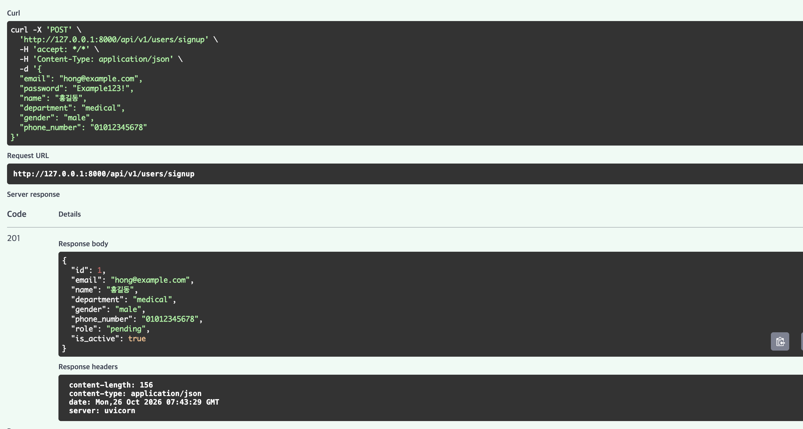
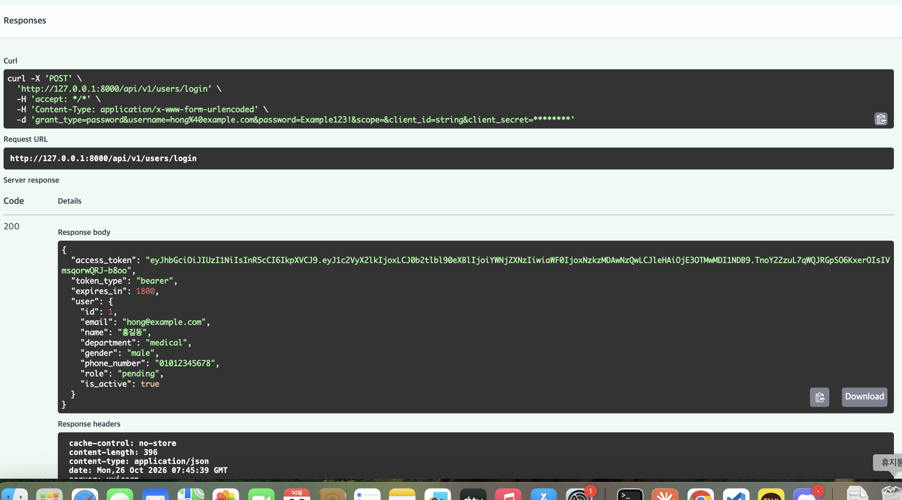
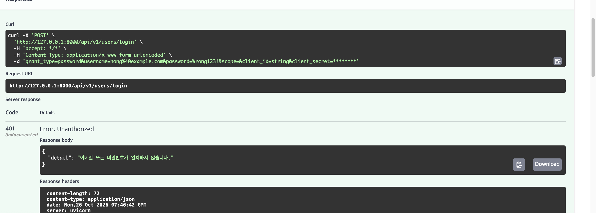
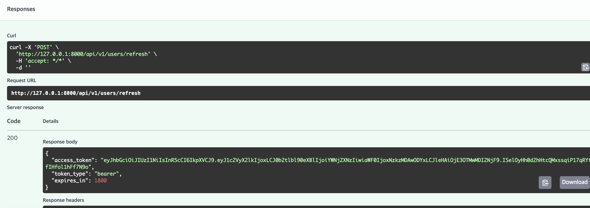
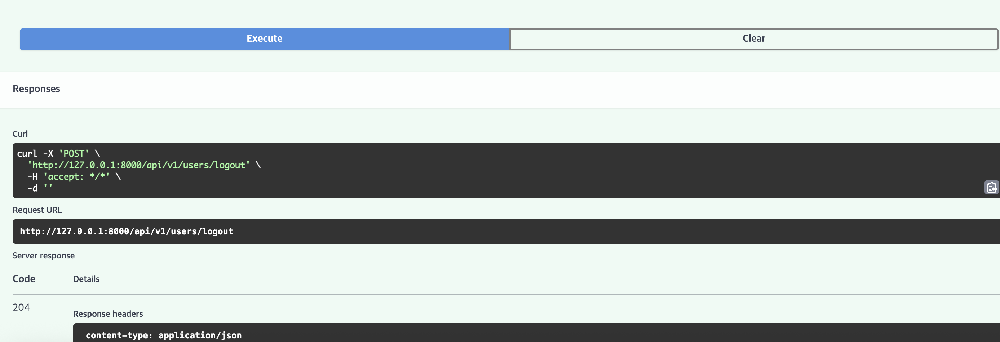
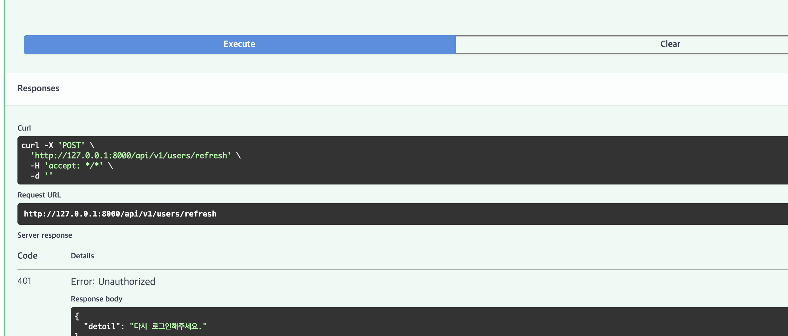

# 4일차 로그인·JWT 인증 구현

> **목적**: 팀 User API 중 내가 맡은 **로그인, JWT 발급·검증·재발급, 로그아웃**을 설계 문서에 맞춰 구현하고, Swagger로 동작을 검증한다. 구현 과정에서 내린 결정과 그 이유, 팀원 코드와 합치며 겪은 충돌 해결 과정을 함께 기록한다.

| 항목 | 내용 |
|---|---|
| 팀 저장소 | [thgPwls98/OZ_codingSchool](https://github.com/thgPwls98/OZ_codingSchool) |
| 내 PR | [#18 로그인·토큰 재발급·로그아웃 API 및 JWT 인증 기능 구현](https://github.com/thgPwls98/OZ_codingSchool/pull/18) |
| 담당 | 2번: 로그인, JWT 발급·검증·재발급, 로그아웃 |
| 브랜치 | `feature/user-auth` |
| 사용 기술 | FastAPI, PyJWT, SQLAlchemy(Async), Pydantic v2 |

## 목차
1. [팀 역할 분담](#1-팀-역할-분담)
2. [요구사항과 API 명세](#2-요구사항과-api-명세)
3. [인증 흐름](#3-인증-흐름)
4. [구현 내용](#4-구현-내용)
5. [설계하며 내린 결정](#5-설계하며-내린-결정)
6. [팀원 코드와 합치기 (충돌 해결)](#6-팀원-코드와-합치기-충돌-해결)
7. [Swagger 테스트 결과](#7-swagger-테스트-결과)
8. [배운 점](#8-배운-점)

---

## 1. 팀 역할 분담

| 순번 | 담당 | 맡은 기능 |
|---|---|---|
| 1 | 강선영 | 회원가입, 비밀번호 해싱 공통 기능, 모델 수정·마이그레이션 |
| **2** | **최현영** | **로그인, JWT 발급·검증·재발급, 로그아웃** |
| 3 | 소혜진 | 관리자 회원 목록 조회, 권한 변경 |
| 4 | 김지영 | 마이페이지 조회·수정, 비밀번호 변경, 회원 탈퇴 |

내가 만든 JWT 검증 기능(`get_current_user`, `require_admin`)은 3·4번 담당자의 API가 모두 사용하는 **공통 인증 기반**이다. 그래서 회원가입(1번) 다음 순서로 Merge되어야 했다.

```text
① 회원가입 + 비밀번호 해싱 + 마이그레이션 (#17)
        ↓
② 로그인 + JWT 인증 기반 (#18)  ← 내 작업
        ↓
③ 관리자 API / ④ 마이페이지 API (순서 무관)
```

---

## 2. 요구사항과 API 명세

### 2-1. 관련 요구사항

| ID | 내용 |
|---|---|
| REQ-USER-002 | 이메일과 비밀번호로 로그인한다. |
| REQ-USER-003 | 로그아웃하면 로그인 페이지로 전환된다. |
| NFR-USER-001 | 로그인 시 JWT 발급. Access Token 30분, Refresh Token 7일. Refresh Token은 **http_only 쿠키**로 전달. payload에는 **user_id만** 저장. |

### 2-2. API 목록

| API | Method | 경로 | 성공 | 실패 |
|---|---|---|---|---|
| 로그인 | `POST` | `/api/v1/users/login` | `200` | `401` 불일치, `403` 비활성 |
| 토큰 재발급 | `POST` | `/api/v1/users/refresh` | `200` | `401` 재로그인 필요, `403` 비활성 |
| 로그아웃 | `POST` | `/api/v1/users/logout` | `204` | 없음 (쿠키가 없어도 `204`) |

> 경로는 저장소에 이미 있던 프론트엔드 코드(`static/apis.js`)가 호출하는 주소에 맞췄다. 로그인 요청도 화면이 보내는 형식 그대로 **폼 데이터(`username`, `password`)** 로 받는다.

### 2-3. 로그인 응답

```json
{
  "access_token": "eyJhbGciOiJIUzI1NiIs...",
  "token_type": "bearer",
  "expires_in": 1800,
  "user": {
    "id": 1,
    "email": "hong@example.com",
    "name": "홍길동",
    "department": "medical",
    "gender": "male",
    "phone_number": "01012345678",
    "role": "pending",
    "is_active": true
  }
}
```

```text
Set-Cookie: refresh_token=eyJ...; HttpOnly; Path=/api/v1/users; Max-Age=604800; SameSite=Lax
Cache-Control: no-store
```

---

## 3. 인증 흐름

```text
[브라우저]                                   [서버]
    │  ① POST /users/login (이메일, 비밀번호)     │
    │ ─────────────────────────────────────────▶ │ 비밀번호 해시 검증
    │  ◀ access_token (본문) + refresh 쿠키       │
    │                                            │
    │  ② API 요청  Authorization: Bearer <access> │
    │ ─────────────────────────────────────────▶ │ get_current_user
    │                                            │ → 토큰 검증 → DB에서 회원 조회
    │                                            │
    │  ③ 30분 후 Access 만료 → POST /users/refresh │
    │    (쿠키는 브라우저가 자동 전송)              │
    │ ─────────────────────────────────────────▶ │ refresh 토큰 검증
    │  ◀ 새 access_token                          │
    │                                            │
    │  ④ POST /users/logout                       │
    │ ─────────────────────────────────────────▶ │
    │  ◀ 204 + 쿠키 삭제 지시 (Max-Age=0)          │
```

| 토큰 | 유효기간 | 전달 방식 | 이유 |
|---|---|---|---|
| Access Token | 30분 | 응답 본문 → `Authorization` 헤더 | 자주 쓰이므로 탈취 피해를 줄이려고 짧게 |
| Refresh Token | 7일 | HttpOnly 쿠키 | 자바스크립트로 읽을 수 없어 XSS로 탈취되기 어려움 |

---

## 4. 구현 내용

### 4-1. 파일 구성

| 파일 | 계층 | 내용 |
|---|---|---|
| `app/core/config.py` | Infrastructure | JWT 비밀키, 알고리즘, 만료 시간, 쿠키 Secure 설정 |
| `app/core/security.py` | Infrastructure | JWT 생성·검증 함수 (비밀번호 해싱은 1번 담당) |
| `app/core/dependencies.py` | Infrastructure | `get_current_user`, `require_admin` 의존성 |
| `app/schemas/auth.py` | Presentation | `LoginResponse`, `TokenResponse` |
| `app/apis/auth.py` | Presentation | 로그인·재발급·로그아웃 API |
| `app/main.py` | - | `auth_router` 등록 |

### 4-2. 토큰 함수 (`core/security.py`)

```python
def _create_token(user_id: int, token_type: TokenType, expires_delta: timedelta) -> str:
    now = datetime.now(UTC)
    payload = {
        "user_id": user_id,          # 사용자 식별 정보는 이것만
        "token_type": token_type,    # "access" 또는 "refresh"
        "iat": now,                  # 발급 시각
        "exp": now + expires_delta,  # 만료 시각
    }
    return jwt.encode(payload, settings.JWT_SECRET_KEY, algorithm=settings.JWT_ALGORITHM)


def decode_token(token: str, expected_type: TokenType) -> int | None:
    try:
        payload = jwt.decode(token, settings.JWT_SECRET_KEY, algorithms=[settings.JWT_ALGORITHM])
    except jwt.InvalidTokenError:     # 서명 위조, 만료 등
        return None
    if payload.get("token_type") != expected_type:  # access ↔ refresh 혼용 차단
        return None
    user_id = payload.get("user_id")
    return user_id if isinstance(user_id, int) else None
```

### 4-3. 인증 의존성 (`core/dependencies.py`)

```python
async def get_current_user(token: ..., db: ...) -> User:
    user_id = decode_token(token, "access")
    user = await UserRepository(db).get_by_id(user_id) if user_id is not None else None
    if user is None:          # 위조·만료·탈퇴한 회원
        raise HTTPException(401, "인증 정보가 유효하지 않습니다.", headers={"WWW-Authenticate": "Bearer"})
    if not user.is_active:    # 비활성 계정
        raise HTTPException(403, "비활성화된 사용자입니다.")
    return user

CurrentUser = Annotated[User, Depends(get_current_user)]
AdminUser = Annotated[User, Depends(require_admin)]
```

다른 팀원은 파라미터 한 줄로 인증을 붙일 수 있다.

```python
@router.get("/me")
async def get_me(current_user: CurrentUser): ...

@router.get("/admin/users")
async def get_users(admin: AdminUser): ...    # 어드민이 아니면 자동으로 403
```

### 4-4. 로그인 (`apis/auth.py`)

```python
@router.post("/login", response_model=LoginResponse, summary="로그인")
async def login(response: Response, form_data: OAuth2PasswordRequestForm, db: ...):
    email = form_data.username.strip().lower()
    user = await UserRepository(db).get_by_email(email)

    if user is None or not verify_password(form_data.password, user.hashed_password):
        raise HTTPException(401, "이메일 또는 비밀번호가 일치하지 않습니다.")
    if not user.is_active:
        raise HTTPException(403, "비활성화된 사용자입니다.")

    _set_refresh_cookie(response, create_refresh_token(user.id))
    response.headers["Cache-Control"] = "no-store"
    return LoginResponse(access_token=create_access_token(user.id), expires_in=1800, user=user)
```

---

## 5. 설계하며 내린 결정

| 결정 | 이유 |
|---|---|
| 로그인 실패 메시지를 **"이메일 또는 비밀번호"** 로 통일 | 어느 쪽이 틀렸는지 알려주면 가입된 이메일 목록을 알아낼 수 있다. |
| `decode_token`이 예외 대신 **`None` 반환** | 상황마다 API 쪽에서 알맞은 상태 코드(401/403)와 메시지를 고를 수 있다. |
| 토큰에 **`token_type`** 추가 | 7일짜리 Refresh Token을 Access Token 자리에 넣어 쓰는 것을 막는다. |
| 쿠키 설정을 **도우미 함수**로 분리 | 브라우저는 발급 때와 같은 `Path`로 삭제해야 쿠키를 지운다. 설정을 한곳에 모아 실수를 막았다. |
| 재발급 실패 시 **쿠키도 삭제** | `HTTPException`을 던지면 쿠키 삭제가 응답에 실리지 않아, `JSONResponse`를 직접 만들어 반환했다. |
| 매 요청마다 **DB에서 회원 조회** | 탈퇴·비활성·권한 변경이 토큰 만료를 기다리지 않고 즉시 반영된다. |
| 서버 세션 저장소는 **이번 범위에서 제외** | 팀 설계 문서 13절 결정. 대신 로그아웃 후에도 복사된 토큰은 만료 전까지 유효하다는 한계를 문서에 명시했다. |
| `OAuth2PasswordRequestForm` 사용 | 프론트 화면의 폼 데이터 형식과 맞고, Swagger에 🔒 Authorize 버튼이 생겨 테스트가 편하다. |

---

## 6. 팀원 코드와 합치기 (충돌 해결)

1번 담당자의 회원가입 PR(#17)이 먼저 Merge된 뒤, 최신 `main`을 내 브랜치에 합치자 충돌이 3개 발생했다.

```bash
git switch main && git pull
git switch feature/user-auth
git merge main
# CONFLICT (add/add): app/core/security.py
# CONFLICT (content): app/main.py
# CONFLICT (add/add): app/schemas/user.py
```

| 파일 | 원인 | 해결 |
|---|---|---|
| `core/security.py` | 둘 다 새로 만듦 (해싱 / JWT) | 두 내용을 **합침** |
| `main.py` | 둘 다 라우터 등록 줄 추가 | **두 줄 모두 유지** |
| `schemas/user.py` | 둘 다 `UserResponse` 작성 | 검증이 더 꼼꼼한 **팀원 버전 채택** |
| `repositories/` | 내 함수형 `user.py` ↔ 팀원 클래스형 `user_repository.py` | 내 파일을 지우고 **`UserRepository`로 통일** |

> 같은 기능이 두 군데 있으면 이후 유지보수가 어렵다. 먼저 Merge된 팀원 코드를 기준으로 맞추는 것이 팀 코드 일관성에 맞다고 판단했다.

---

## 7. Swagger 테스트 결과

| 순서 | 테스트 | 기대 | 결과 |
|---|---|---|---|
| ① | 회원가입 | `201`, `role: pending` | ✅ |
| ② | 로그인 | `200`, 토큰 + 사용자 정보 | ✅ |
| ③ | 비밀번호 틀림 | `401` | ✅ |
| ④ | 토큰 재발급 (요청 본문 없음) | `200`, 새 토큰 | ✅ 쿠키 자동 전송 확인 |
| ⑤ | 로그아웃 | `204` | ✅ |
| ⑥ | 로그아웃 후 재발급 | `401` "다시 로그인해주세요." | ✅ 쿠키 삭제 확인 |

**① 회원가입**


**② 로그인**


**③ 비밀번호 틀림**


**④ 토큰 재발급**


**⑤ 로그아웃**


**⑥ 로그아웃 후 재발급**


---

## 8. 배운 점

- **설계 문서를 먼저 확인하는 이유**: 처음에는 요구사항만 보고 주소를 정했는데, 저장소에 이미 있던 프론트 코드는 다른 주소를 호출하고 있었다. 코드를 짜기 전에 **기존 코드와의 계약(API 주소, 필드 이름)** 을 확인해야 한다.
- **HttpOnly 쿠키의 의미**: Swagger 화면에서 `set-cookie`가 보이지 않았지만, 요청 본문 없이 재발급이 성공한 것으로 쿠키가 저장·전송되고 있음을 확인했다. 자바스크립트가 읽을 수 없다는 것이 곧 보안상의 장점이다.
- **JWT는 암호화가 아니라 서명**: 토큰을 jwt.io에 붙여넣으면 payload가 그대로 보인다. 그래서 개인정보를 넣지 않고 `user_id`만 넣는다.
- **비밀키 길이 경고**: 짧은 비밀키를 쓰자 PyJWT가 `InsecureKeyLengthWarning`을 냈다. HS256에는 32바이트 이상의 무작위 키를 `.env`로 관리해야 한다.
- **협업에서의 Merge 순서**: 다른 사람이 의존하는 공통 기능은 먼저 Merge되어야 하고, 같은 파일을 동시에 만들면 충돌은 자연스럽게 생긴다. 충돌은 내 컴퓨터에서 먼저 해결하고 다시 테스트한 뒤 PR을 올린다.
